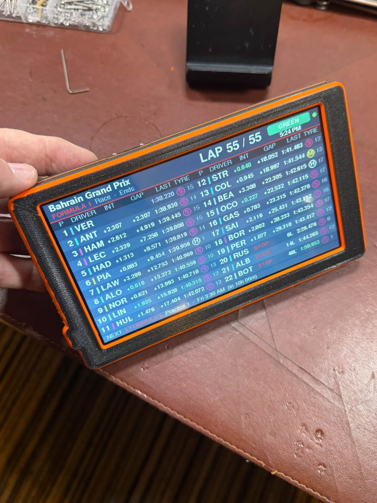

# Race Tracker 5000

A trackside live-timing screen for Formula 1, F1 Academy and Porsche Carrera Cup
North America, built on a 7" Elecrow CrowPanel ESP32 display, plus a 3D-printed
case with room for a 10,000 mAh battery.

I built it to use at my flag marshal post. The firmware and the case were
written with an AI (Claude) as the hands; the ideas, choices, printing and
testing are mine. The full story is on [Just A Guy 3D](https://justaguy3d.com).

The case is also on Printables, with a print-ready 3MF:
[Just-A-7" CrowPanel Case](https://www.printables.com/model/1871230-just-a-7-crowpanel-case-for-the-elecrow-crowpanel).

## What it does

- Live leaderboard for F1, F1 Academy or Porsche Carrera Cup NA, straight from
  the series' own live-timing feeds over Wi-Fi. No relay computer, no logins.
- Menu (press and hold the screen): series, brightness, auto-switch, schedule
  and Wi-Fi.
- Schedule of upcoming sessions, and a NEXT bar showing the next session.
- On-screen Wi-Fi setup, so you can join a hotspot at the track without a PC.
- Optional auto-switch to whichever series is on track.

## What's in this repository

| Folder | Contents |
|---|---|
| [`firmware/`](firmware/) | PlatformIO project for the CrowPanel. Setup, settings and how to add your own series are in [firmware/README.md](firmware/README.md). |
| [`enclosure/`](enclosure/) | OpenSCAD source and print-ready STLs for the case (also on [Printables](https://www.printables.com/model/1871230-just-a-7-crowpanel-case-for-the-elecrow-crowpanel) as a 3MF). Print and assembly notes are in [enclosure/README.md](enclosure/README.md). |
| [`docs/images/`](docs/images/) | Photos and renders. |

## Bill of materials

**Electronics**
- Elecrow CrowPanel 7.0" HMI ESP32 display, DIS08070H (board revision V3.0)
- 3.7 V LiPo, 10,000 mAh, size 1160100 (about 11 × 60 × 100 mm), with a
  JST PH 2.0 plug. Check the red and black wires against the + and − marks by
  the BAT socket before plugging it in: these plugs aren't wired the same way
  by every maker.
- Panel-mount slide switch, SS12F16. It's rated 0.5 A, which is on the low side
  for this screen.
- A short length of hookup wire, to put the switch in the battery's positive
  lead
- USB-C data cable, for loading the firmware and for charging

**Hardware**
- 4 × M3 heat-set inserts (4 mm long, 5 mm outside diameter)
- 4 × M3 × 8 mm screws
- 2 × M2 × 5 mm screws, for the switch
- 3 mm foam tape: two pads of about 100 × 60 mm, one each side of the battery

**Printed parts**
- Front bezel, rear shell and a two-piece TPU gasket
- Optional: a fit gauge, a quick test print to check the outline and screw
  holes
- Filament: PETG or PLA for the shell (PETG copes better with the flexing
  button tabs), plus TPU for the gasket

**Tools**
- Soldering iron, for the heat-set inserts and the switch wiring
- Hex key or screwdriver to suit your screws

## Credits

- **Board dimensions** come from Elecrow's published design files for the
  CrowPanel 7.0" V3.0:
  [Elecrow-RD/CrowPanel-7.0-HMI-ESP32-Display-800x480](https://github.com/Elecrow-RD/CrowPanel-7.0-HMI-ESP32-Display-800x480).
- **The case** takes its overall approach (and the optional honeycomb back in
  the OpenSCAD source) from the
  [ACOS Elecrow CrowPanel Advance 7 enclosure](https://www.printables.com/model/1476807-elecrow-crowpanel-advance-7-enclosure)
  by Alley Cat / Majestic AV, LLC, licensed CC BY-SA 4.0.
- **Code and CAD** were written with Claude (made by Anthropic). Everything was
  tested on real hardware and real prints by me.

## Licences

- **Firmware** (`firmware/`): MIT, see [LICENSE](LICENSE).
- **Enclosure** (`enclosure/`): CC BY-SA 4.0, as a derivative of the ACOS
  design, see [enclosure/LICENSE.md](enclosure/LICENSE.md).
- **Photos and renders** (`docs/images/`): CC BY-SA 4.0.

## Notes

- The F1 Academy and Porsche connections use the same data sources as those
  series' public live-timing web pages. They aren't published for outside use
  and can change or stop working without notice.
- Formula 1, F1 Academy, Porsche and Carrera Cup are trademarks of their
  owners. The series logos are not included here; see firmware/README.md.
- This project is not affiliated with Elecrow, Formula 1, F1 Academy, Porsche,
  Anthropic or Snapmaker.
