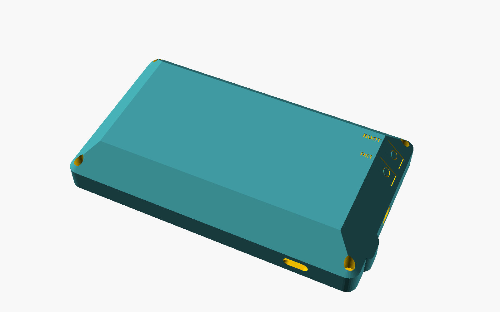

# Enclosure

A two-part case for the Elecrow CrowPanel 7.0" (DIS08070H, board V3.0) with a
battery bay, a 45° bevelled back, flush BOOT and RESET buttons, and a TPU
gasket. About 190 × 110 × 33.5 mm.

The print-ready 3MF is on Printables:
[Just-A-7" CrowPanel Case](https://www.printables.com/model/1871230-just-a-7-crowpanel-case-for-the-elecrow-crowpanel).



## Files

| File | What it is |
|---|---|
| `stl/front-bezel.stl` | Front bezel. Holds the screen and the four heat-set inserts. |
| `stl/rear-shell-plain.stl` | Rear shell. |
| `stl/gasket-tpu.stl` | Gasket, two pieces. Print in TPU. |
| `stl/fit-gauge.stl` | Optional quick test print to check the outline and screw holes. |
| `crowpanel7_case.scad` | OpenSCAD source for all of the above. |

The STLs are already in print orientation.

## Printing

- **Front bezel:** face down. No supports.
- **Rear shell:** back down. No supports: every overhang, including the bevel,
  is 45° or less. The screw-head pockets leave a 0.2 mm skin under each seat so
  it bridges cleanly; push the screw through it the first time.
- **Gasket:** flat, as exported, in TPU at 0.2 mm layers. The sealing fin is a
  single 0.4 mm line, so use a 0.4 mm nozzle and make sure the slicer doesn't
  drop thin walls.
- **Material:** PETG or PLA for the shell. PETG copes better with the flexing
  button tabs.
- I printed mine on a Snapmaker U1.

## Assembly

1. Melt the four M3 heat-set inserts into the bosses in the front bezel.
2. Put the board in the bezel, screen down.
3. Plug the battery into the BAT socket. The plug sits in the small pod on
   the side of the case.
4. Lay the gasket in the channel around the bezel rim, fin up.
5. Stick the battery, with 3 mm foam tape on both faces, into the pocket in
   the rear shell, leads through the slot in the pocket wall.
6. Fit the slide switch to the inside of the top wall with two M2 × 5 mm
   screws from outside, wired into the battery's positive lead.
7. Close the case. The snap ridges along the edges click into the bezel lip.
   Fit the four M3 × 8 mm screws through the rear shell into the inserts.

To open it again, take out the screws, then flex the bezel lip outward at the
USB-C opening to release the snap ridges.

**BOOT and RESET** are the two flexing tabs on the bevel near the USB-C side.
Press inside the engraved rings. If the touchscreen stops responding, hold
both for about 10 seconds (see the firmware README).

## Changing the design

Everything is parameters at the top of `crowpanel7_case.scad`: battery size,
foam thickness, wall thickness, chamfers, button gap and so on. Pick the part
to export with `part`, for example:

```
openscad -o front-bezel.stl -D 'part="bezel"' crowpanel7_case.scad
```

The source can also make a rear shell with a honeycomb back (`rear`), and a
two-colour version of it (`rear_2c_body` + `rear_2c_hex`).

Parts: `bezel`, `bezel_label` (front with a text label; needs a font installed
on your PC, see `label_font`), `bezel_text` (just the label, for a second
colour), `rear`, `rear_plain`, `rear_2c_body`, `rear_2c_hex`, `gasket`,
`gauge`, and `assembly` (exploded view over a model of the board).

The board dimensions come from Elecrow's V3.0 design files. Earlier boards
(V1.0, V2.0) may differ.

## Licence

CC BY-SA 4.0, as a derivative of the ACOS Elecrow CrowPanel Advance 7
enclosure by Alley Cat / Majestic AV, LLC. See [LICENSE.md](LICENSE.md).
